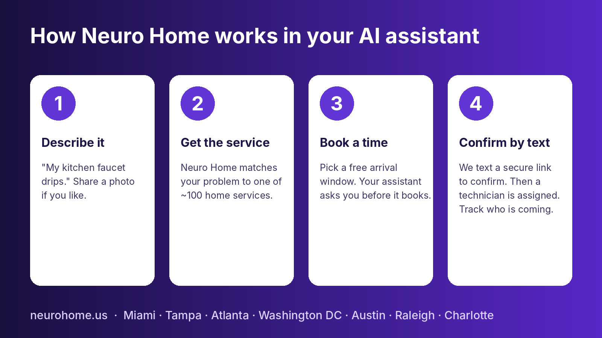

<p align="center"></p>

# Neuro Home: book any home service from your AI assistant

**Remote MCP server:** `https://mcp.neurohome.us/neuro-home/mcp` · **Registry:** `us.neurohome/neuro-home` · **Website:** https://neurohome.us/ai/


**Book any home service without leaving your AI chat.** Installation, furniture assembly, TV mounting, home repairs,
plumbing and electrical fixtures, painting, smart home and appliance installs: Neuro Home books all of it. Tell ChatGPT, Claude or any MCP
client what is wrong at home, in your own words or with a photo. Neuro Home finds the matching service from around 100 home
jobs, offers free arrival times and books a technician. Then it tells you who is coming and when.

**Who it is for:** homeowners and renters, landlords and property managers, and busy families in Miami, Tampa, Atlanta,
Washington DC, Austin, Raleigh and Charlotte who want a repair booked in one conversation instead of calling around.

#### What you can ask
- "My kitchen faucet is dripping. What would a fix cost and when can someone come?"
- "Book someone to mount my 65-inch TV this week."
- "Here is a photo of the hole in my wall. Can you patch it?"
- "I need a ceiling fan installed in the bedroom on Saturday morning."
- "Assemble my new desk and two chairs tomorrow."
- "Who is coming to my visit and when?"
- "Move my appointment to Friday afternoon."
- "Show me the bill for my last visit."

#### How it works
1. **Describe it.** Say what is wrong, or share up to three photos. Neuro reads them and picks the matching service.
2. **Know before you book.** Neuro Home names the matching service and shows what it costs before anything is booked.
3. **Book a time.** Pick one of the free arrival windows. Your assistant asks you before it books or moves anything.
4. **Confirm by text.** Nothing is paid in the chat. We text your phone a secure link to confirm the booking on our website. Once it is confirmed, a technician is assigned.
5. **Track it.** Ask who is coming and when, move the visit, and see the final bill after the work.

#### Services (around 100 jobs in 10 groups)
- **Handyman and small repairs:** a handyman for a list of small fixes, caulking and grouting, recaulk a tub, shower or sink, tighten loose handles and hinges, weatherstripping and door sweeps, caulk drafty windows, smoke and CO detector test, battery swap or replacement.
- **Mounting and hanging:** TV mounting (up to 60″, 61–85″, over 85″), on brick, concrete or over a fireplace, hide the wires inside the wall, soundbar mounting, shelves and floating shelves, pictures, mirrors and art, curtain rods, blinds and shades, shower rod or handheld shower holder.
- **Furniture assembly:** desks and tables, chairs, dressers, wardrobes, beds, shelving units.
- **Plumbing fixtures:** kitchen or bathroom faucet replacement, faucet or shower cartridge, shower head swap, toilet replacement, toilet tank repair (flapper or fill valve), running toilet check, leaks under the sink, drain trap, supply lines and shut-off valves, garbage disposal replacement, bidet seat, bathroom vanity install.
- **Electrical fixtures:** ceiling fan install or swap, light fixture swap, switch, outlet and dimmer swap, fan control on the wall.
- **Smart home:** smart doorbell, wireless camera, smart thermostat, smart lock.
- **Doors and locks:** interior door install (pre-hung), sticking or swinging door adjustment, hinge and latch fixes, deadbolt or mortise lock change, rekeying, handle replacement.
- **Walls and painting:** drywall patching (holes, dents, cracks, corners), paint the patch, interior painting by quote, tile work (backsplash, floor, shower) by quote.
- **Appliances and AC:** dishwasher install, washer and dryer hookup, water supply hose, AC air filter replacement, vent and return grille cleaning, thermostat install.
- **Outside and safety:** grab bar install, pressure washing by quote, deck and fence repair by quote.

Bigger plumbing and electrical work (new circuits, panels, gas lines, permitted plumbing) is not booked in the chat. Ask, and
our office arranges it with a licensed contractor.

#### Why people use it
- **One conversation, not ten calls.** Service, time and booking in the same chat.
- **No surprises.** You see what the job costs before you book, straight from Neuro Home.
- **You stay in control.** Your assistant only sees your own Neuro Home account, and it asks before it books or moves a visit.
- **Fair rules.** Free cancellation up to 24 hours before the visit. 30-day workmanship guarantee. Insured technicians.

#### Privacy and security
You connect your own Neuro Home account by signing in with your phone number and a code we text you (OAuth 2.1 with PKCE).
The assistant never sees card details and never moves money: anything you pay, you pay on our own website, by the link we text you.
Privacy policy: https://neurohome.us/neurohome-privacy.html · Terms: https://neurohome.us/neurohome-terms.html

#### Connect
- **MCP server URL:** `https://mcp.neurohome.us/neuro-home/mcp`
- **Claude:** Settings → Connectors → Add custom connector → paste the URL → Connect.
- **ChatGPT:** Settings → Apps → add the Neuro Home app (or, in developer mode, a connector with the URL above).
- **Any MCP client:** add a remote server with the URL above; sign-in opens in your browser.

Questions: hello@neurlead.com · Website: https://neurohome.us

## Tools

| Tool | What it does | Read only | Changes data |
|---|---|---|---|
| list_services | Lists the home services that can be booked, with how each is priced | yes | no |
| estimate_price | Matches a described or photographed problem to a service and shows what it costs | yes | no |
| list_homes | The customer's saved homes | yes | no |
| add_home | Saves an address to the customer's own account | no | yes |
| find_times | Free arrival windows for a home | yes | no |
| book_visit | Reserves a visit; we text the customer a link to confirm it; a technician is assigned once it is confirmed | no | yes (destructive hint) |
| list_visits | The customer's upcoming and past visits | yes | no |
| get_visit | One visit: status, arrival window, technician first name and ETA | yes | no |
| find_new_times | Windows a visit can move to | yes | no |
| reschedule_visit | Moves a visit to a new time; the technician is told | no | yes (destructive hint) |
| get_bill | The final bill after the work | yes | no |

No tool takes card data, returns a payment link, cancels, tips, disputes or moves money.

## FAQ

- **What is Neuro Home?** A home-repair booking service you can use inside ChatGPT, Claude and other AI assistants. It matches your problem to one of around 100 home services and books a technician at your home.
- **Where does Neuro Home work?** Miami, Tampa, Atlanta, Washington DC, Austin, Raleigh and Charlotte.
- **How much does a repair cost with Neuro Home?** Ask your assistant, for example "how much to fix a leaking faucet". Neuro Home shows the cost for your job before anything is booked.
- **What home services can I book?** Around 100 jobs: plumbing fixtures, electrical fixtures, TV mounting, furniture assembly, drywall, doors and locks, smart home, appliances, painting, tile and more.
- **Do I pay in the chat?** No. After you book, we text your phone a secure link to confirm the booking on our website.
- **Can I cancel?** Yes, for free up to 24 hours before the visit.
- **Is the work guaranteed?** Yes, with a 30-day workmanship guarantee.
- **Does Neuro Home do electrical and plumbing?** Fixture work, yes: faucets, toilets, disposals, ceiling fans, lights, switches and outlets. Bigger jobs such as new circuits, panels, gas or permitted plumbing go through our office, which arranges a licensed contractor.
- **What can the AI assistant see?** Only your own Neuro Home account: your homes, visits and bills. It asks you before it books or moves a visit.
- **How do I connect it?** Add the MCP server `https://mcp.neurohome.us/neuro-home/mcp` in your assistant, then sign in with your phone number and the code we text you.


## Example prompts

1. My kitchen faucet is dripping. What would a fix cost and when can someone come?
2. Book someone to mount my 55-inch TV this week.
3. Here is a photo of a hole in my drywall. Can you patch it and when?
4. Install a ceiling fan in my bedroom on Saturday morning.
5. Assemble a desk and two chairs at my place tomorrow.
6. My toilet keeps running. Can someone fix it this week?
7. Swap my old thermostat for a smart one.
8. Who is coming to my next visit and when?
9. Move my appointment to Friday afternoon.
10. Show me the bill for my last visit.

Negative examples (the connector should not be used): "Find me a roofer in Seattle" (outside the service area), "Rewire my
electrical panel" (needs a licensed contractor, handled by the office), "Pay my bill with this card" (no payments in chat).


## Install

Claude: Settings → Connectors → Add custom connector → `https://mcp.neurohome.us/neuro-home/mcp`

Any MCP client:

```json
{
  "mcpServers": {
    "neuro-home": { "type": "streamable-http", "url": "https://mcp.neurohome.us/neuro-home/mcp" }
  }
}
```

Sign-in opens in your browser: your phone number and a code we text you (OAuth 2.1, PKCE, dynamic client registration).



## Links

- Website and AI docs: https://neurohome.us/ai/
- Privacy policy: https://neurohome.us/neurohome-privacy.html
- Terms of service: https://neurohome.us/neurohome-terms.html
- Support: hello@neurlead.com

This repository holds the public documentation and listing assets for the hosted Neuro Home MCP server. It contains no server code.
